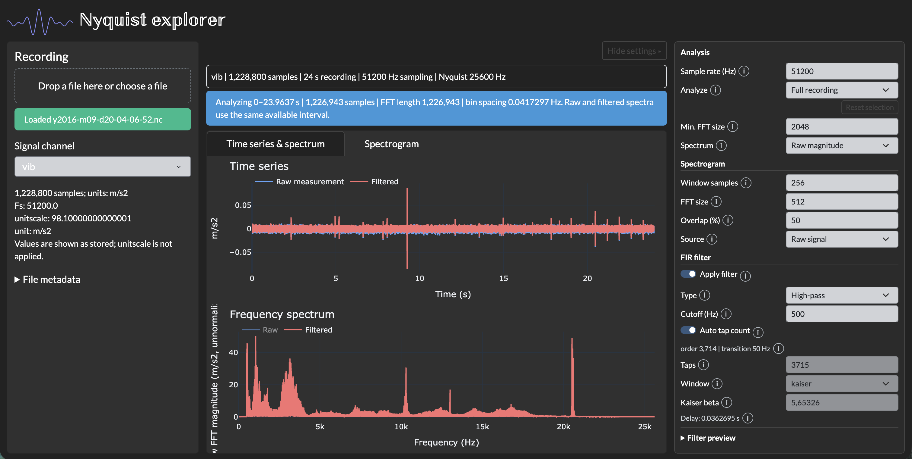

# Nyquist explorer

A simple vibration analysis tool. Upload a recording and explore its time series, spectrum, and spectrogram, with optional FIR filtering.



## Updates

* New look with a dark theme
* Updated packages and Python 3.14
* Automatic FIR filter settings

## Setup

```sh
git clone https://github.com/karanrajagopalan/Nyquist-explorer.git
cd Nyquist-explorer
```

### Run locally

Requires Python 3.14 and Poetry.

```sh
poetry env use python3.14
poetry sync
poetry run python app/Nyquist_explorer.py
```

### Run with Docker

```sh
docker build ./ -t nyquist_explorer
docker run -p 8050:8050 nyquist_explorer
```

Open [http://localhost:8050](http://localhost:8050).

## Usage

1. Upload a NetCDF (`.nc`), MATLAB (`.mat`, v7.2 or earlier) or CSV (`.csv`) recording. In `.mat` files, vector variables become channels and scalar variables (e.g. `X109RPM`) are shown as file metadata.
2. Pick one or more signal channels and check the sampling rate. Selected channels are overlaid in the time series and spectrum. Channels are assumed to share one sampling rate. On the Spectrogram tab, choose which selected channel to show.
3. Zoom the time series to analyze a selected interval, or analyze the full recording.
4. Adjust the spectrum and spectrogram settings. The spectrum marks the shaft speed (1X) and its harmonics with dotted lines. The speed is read from the file's RPM metadata when present, otherwise enter it under **Shaft speed (RPM)**; clear it to hide the markers.
5. Optionally enable a low-pass, high-pass, or band-pass FIR filter. Tap count and window are set automatically, or switch that off to set them yourself.

Use **Hide settings** to give the charts more room.

## Tests

```sh
poetry run python -m unittest discover -s tests -v
```
