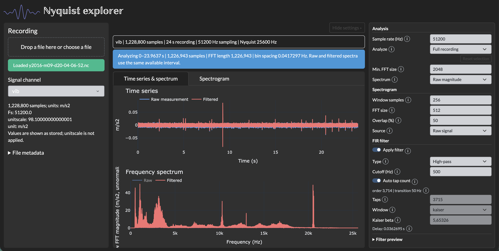

# Nyquist explorer

The app header uses the waveform logo stored in [app/assets/logo.png](app/assets/logo.png).

## Major update: new look

This release is a major visual update:

* **Dark theme** across the app (Bootstrap Darkly) with dark Plotly charts and
  brighter raw/filtered trace colors.
* **Light-grey inputs and dropdowns** with dark text for readable controls on the
  dark background.
* **Double-struck (blackboard bold) title** and a logo blended into the dark header.
* **Collapsible settings panel** on desktop: use the **Hide settings / Show settings**
  button above the plots to give the charts the full right-hand space.

Analysis behavior is unchanged. The Docker image now sets Python runtime
environment variables, disables the pip cache, declares port 8050, and starts
gunicorn in exec form.
 
## Setup
* Clone the repository.

`git clone https://github.com/karanrajagopalan/Nyquist-explorer.git`

You can choose one of the below methods to run the app

1. run the app from your local setup by installing the required version of python and the needed packages 
(or)
2. run the app as a docker container by building its docker image. You'll need to install docker in that case.

### Running locally
* Install Python **3.14** and Poetry **2.2.1 or later**. Python 3.9 is no longer
  supported. Python 3.14 is the validated runtime; newer feature releases are not
  yet tested.
  The migrated local environment was validated with **Python 3.14.10**.
  Its project-local interpreter is retained under `.python/` (ignored by Git);
  do not delete that directory while `.venv` is using it. Other machines can
  use their own installed Python 3.14 interpreter.
* From the repository root, create the project-local environment and install
  the locked runtime and development dependencies:

```sh
poetry env use python3.14
poetry sync
```

Poetry keeps the environment in `.venv`. In VS Code, select `.venv/bin/python`
(Windows: `.venv/Scripts/python.exe`) as the interpreter. If a terminal still has
the old environment activated, run `deactivate` and open a fresh terminal before
using the new environment.

The local Python 3.9 environment from this migration is retained in
`.venv-py39-backup/` and ignored by Git. It is an inactive backup, not a second
supported runtime. Virtual environments contain absolute paths; to roll back,
stop the app and restore this directory to its original `.venv` location along
with the old dependency files, rather than activating the renamed backup.

* From the repository root, start the app:

```sh
poetry run python app/Nyquist_explorer.py
```

### Running docker container
* If you want to run this as a docker container, then you need to build the docker image.
* Install docker. Follow the steps given in docker docs [https://docs.docker.com/get-docker/](https://docs.docker.com/get-docker/)
* With the Nyquist_explorer as your current directory, Build the docker image with the command

 `docker build ./ -t nyquist_explorer`

* Run the container with the command below.
 `docker run -p 8050:8050 nyquist_explorer`

The container uses Python 3.14 and the same locked runtime packages as the local
environment. `requirements.txt` is a generated UTF-8 export; do not edit it
manually. After an intentional dependency update, regenerate it with:

```sh
poetry update
poetry export --only main --without-hashes -o requirements.txt
```

The export plugin is installed locally for this project by `poetry sync`.
Only directly used runtime packages are declared in `pyproject.toml`; Poetry
locks their transitive dependencies. Obsolete standalone Dash component packages,
Windows certificate support, unused scientific packages, and unnecessary
compatibility pins have been removed.

#### NOTE: 
In the both the above cases, you'll be able to access the app from [http://localhost:8050](http://localhost:8050)

## Usage

1. Upload a NetCDF (`.nc`) or UTF-8 CSV (`.csv`) recording. Each one-dimensional
   real numeric NetCDF variable or numeric CSV column becomes a selectable channel.
   Empty, multidimensional, nonnumeric, missing, and non-finite channels are skipped
   with an explanation. Excel files are not supported.
2. Select a channel and verify **Sampling rate (Hz)**. NetCDF channel attributes
   `Fs`, `fs`, or `sampling_rate` supply the initial rate. Without rate metadata,
   the app warns you to verify the default of 50,000 Hz. CSV time columns are not
   automatically interpreted as sampling-rate metadata. Values are used as stored:
   NetCDF `unitscale` is displayed but not applied.
3. **Full recording** is analyzed by default, not just the first second.
   Choose **Selected interval** to analyze the horizontally zoomed portion of the
   time-series plot. The status shows the actual sample-aligned bounds and count.
   Reset selection, plot autorange, a new upload/channel, or a sampling-rate change
   clears the selection. Selected-interval mode waits for a new selection rather
   than silently reverting to the full recording.
4. Choose spectrum scaling and spectrogram settings. Numeric edits apply on Enter
   or when the input loses focus. Invalid inputs show messages and clear the
   affected results; no old result is presented as current.
5. Optionally enable an FIR filter. Choose low-pass, high-pass, or band-pass and
   appropriate cutoff frequencies. Automatic FIR length is enabled by default;
   switch it off to edit the tap count, window, and Kaiser beta manually.
   Band-pass shows a second cutoff; Kaiser shows its beta parameter.

### Spectrum and spectrogram conventions

- Sample times use `1 / fs` spacing, ending at `(N - 1) / fs` for `N` samples.
- **Minimum FFT length** is independent of the FIR tap count. Short intervals are
  zero-padded; longer intervals use all samples without truncation. The effective
  FFT length and `fs / effective NFFT` bin spacing are displayed. Zero-padding
  interpolates the spectrum; it does not improve the underlying resolving power.
- **Raw FFT magnitude (legacy)** retains unnormalized magnitudes. **Amplitude
  (peak)** normalizes by the number of analyzed samples and doubles positive
  frequency bins except DC and the even-length Nyquist bin. **Power spectral
  density** is a single-sided boxcar periodogram in signal-units squared per Hz.
  Spectrum modes do not remove DC or detrend the signal.
- Spectra now include all nonnegative frequency bins, including Nyquist for an
  even FFT length. This extends the earlier plot, which omitted that endpoint.
- Spectrograms have independent window length, FFT length, overlap, and raw/filtered
  source controls. They use a Hamming window and PSD scaling in dB. The FFT length
  must be at least the requested window length; short selections automatically
  shorten the window with a visible notice. Times stay relative to the recording.
  Zero power is floored to the smallest positive float before converting to dB.

### FIR filtering

**Automatic FIR length** uses SciPy's Kaiser order estimate with a **60 dB
attenuation target**. The transition width is 10% of the smallest span between
DC and the first cutoff, the last cutoff and Nyquist, and (for band-pass) the
two cutoffs. The width is normalized by Nyquist for `scipy.signal.kaiserord`;
the resulting tap count is rounded up to an odd value. The Kaiser window and
its estimated beta are set automatically. This is an empirical design estimate,
not a strict attenuation guarantee.

The default recomputes when sampling rate, filter type, or relevant cutoffs change.
For example, `fs = 51,200 Hz` and a `500 Hz` low-pass cutoff give a `50 Hz`
transition width, **3,715 taps** (filter order **3,714**), and beta **5.65326**.
Narrower transitions need longer filters: a `10 Hz` cutoff at the same sampling
rate gives **185,621 taps**, with approximately **1.81 s** of group delay.
The app does not silently cap the estimate. A recording too short for the
resulting delay is rejected as described below. Disable automatic length for
manual control; subsequent rate/cutoff edits do not overwrite manual values.

Cutoffs must lie strictly between zero and Nyquist (`fs / 2`). The tap count must
be odd and at least three. Delay compensation shifts the causal output by
`(tap count - 1) / 2` samples and shortens its end by that amount; it is not
zero-phase filtering, and startup transients may remain. Channels too short for
the configured delay are rejected with a message. Raw and filtered spectra use
the same available interval for comparison. An invalid filter configuration does
not block raw analysis when the filter is off.

### Screen layout

The interface uses a dark theme. On screens 992 pixels wide and above, the
**Hide settings** button above the plots collapses the settings panel so the
plots expand into the freed space; **Show settings** restores it.

The workspace fits the browser viewport without scrolling the whole page.
Desktop shows recording, plots, and settings side by side. Recording metadata
and settings scroll within their own panels; status messages have their own
bounded scroll area so they cannot push plots off-screen. Time-series and
spectrum plots share the available height; the spectrogram uses the full plot
area. On very short screens the plot area scrolls internally to keep each chart
at least 180 pixels tall. Filter previews remain inside the scrollable settings panel.

Below 992 pixels wide, **Recording / Plots / Settings** switches between
full-height sections instead of stacking them beyond the screen. Switching
sections retains the loaded data and settings. Numeric controls apply on Enter
or blur, as on desktop.

Settings use compact label/control rows grouped under Analysis, Spectrogram, and
FIR filter headings. Hover over or keyboard-focus the **i** buttons for
explanations; they can also be tapped on touch screens. Filter order, transition
width, and delay remain as brief summaries, while validation errors stay visible.
Expand **Filter preview** to switch between response and tap plots.

Large-file optimization and analysis exports are not included; recordings are
still held in browser memory.

## Tests

Run the numerical, upload, and callback regression tests from the project root:

```sh
poetry run python -m unittest discover -s tests -v
```


